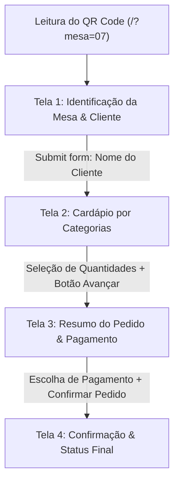

# Especificação de Design e UX/UI: Cardápio Digital por QR Code

**Autor:** Design Lead  
**Destinatários:** Big Boss, Dev Lead, QA Specialist, Cybersecurity Specialist  
**Versão:** 1.0.0  
**Data:** 06/11/2026  
**Status:** Aprovado para Implementação  

---

## 1. Visão Geral e Princípios de Design

O **Cardápio Digital por QR Code** tem como missão proporcionar uma experiência de atendimento ágil, clara e confiável para clientes em mesas de restaurantes e bares através do próprio smartphone.

### Princípios Fundamentais
1. **Mobile-First Real:** Projetado para telas de 360px a 430px de largura, garantindo visualização confortável em qualquer aparelho.
2. **Zero JavaScript (HTML5 + CSS3 Puros):** Toda a interação funcional é baseada em formulários semânticos nativos (`<form>`, `<input>`, `<button>`, rádios estilizados e âncoras).
3. **Ergonomia e Área de Polegar (Thumb Zone):** Elementos interativos críticos (botões de ação, seletores) posicionados no alcance confortável do polegar, com altura mínima de toque de **48px**.
4. **Clareza de Preço e Consumo:** Informações financeiras transparentes, sem letras miúdas ou ambiguidade.
5. **Acessibilidade Visual (WCAG 2.1 AA):** Relação de contraste de cores mínima de 4.5:1 para texto normal e 3:1 para componentes visuais e texto grande.

---

## 2. Design Tokens e Paleta de Cores

A paleta combina tons quentes e apetitosos (terracota/âmbar gastronômico) com neutros refinados de alto contraste.

```css
:root {
  /* Cores Primárias de Marca (Gastronomia / Acolhimento) */
  --color-primary: #C0392B;        /* Terracota marcante para CTAs e destaques */
  --color-primary-dark: #96281B;   /* Hover / Active */
  --color-primary-light: #FADBD8;  /* Fundo de destaque / Badges leves */

  /* Cores Secundárias e Acentos */
  --color-accent: #D35400;         /* Laranja âmbar para preços e alertas amigáveis */
  --color-accent-soft: #FEF5E7;    /* Fundo suave de cards promocionais */

  /* Neutros e Superfícies */
  --color-bg-app: #F8F9FA;         /* Fundo global da aplicação */
  --color-surface: #FFFFFF;        /* Fundo de cards e containers */
  --color-surface-alt: #EDEDED;    /* Fundo secundário / divisores */
  --color-border: #D1D5DB;         /* Bordas sutis de inputs e cards */
  --color-border-focus: #C0392B;   /* Foco em campos */

  /* Tipografia & Contraste */
  --color-text-main: #1F2937;      /* Texto principal (quase preto, contraste > 10:1) */
  --color-text-muted: #4B5563;     /* Descrições e rótulos auxiliares (contraste > 4.5:1) */
  --color-text-inverse: #FFFFFF;   /* Texto sobre fundos escuros/primários */

  /* Feedback e Status */
  --color-success: #1E7E34;        /* Sucesso / Pedido recebido / Pix aprovado */
  --color-success-bg: #E8F5E9;
  --color-warning: #856404;        /* Alerta de pagamento no caixa / dinheiro */
  --color-warning-bg: #FFF3CD;
  --color-warning-border: #FFEBAA;

  /* Espaçamentos (8pt Grid) */
  --space-2xs: 4px;
  --space-xs: 8px;
  --space-sm: 12px;
  --space-md: 16px;
  --space-lg: 24px;
  --space-xl: 32px;

  /* Tipografia Modular */
  --font-family: -apple-system, BlinkMacSystemFont, "Segoe UI", Roboto, Helvetica, Arial, sans-serif;
  --font-size-xs: 0.75rem;    /* 12px */
  --font-size-sm: 0.875rem;   /* 14px */
  --font-size-base: 1rem;     /* 16px */
  --font-size-md: 1.125rem;   /* 18px */
  --font-size-lg: 1.25rem;    /* 20px */
  --font-size-xl: 1.5rem;     /* 24px */
  --font-size-2xl: 1.875rem;  /* 30px */

  /* Raios de Borda e Sombras */
  --radius-sm: 6px;
  --radius-md: 10px;
  --radius-lg: 16px;
  --radius-pill: 9999px;
  --shadow-sm: 0 1px 3px rgba(0, 0, 0, 0.08);
  --shadow-md: 0 4px 10px rgba(0, 0, 0, 0.08);
  --shadow-float: 0 8px 24px rgba(0, 0, 0, 0.15);
}
```

---

## 3. Arquitetura das Telas e Fluxos de UX



---

### Tela 1: Identificação da Mesa & Boas-Vindas (`/`)
* **Objetivo:** Confirmar o número da mesa identificado pelo QR Code e capturar o nome do cliente para personalização e atendimento.
* **Componentes Chave:**
  - **Badge de Mesa:** Destaque visual expressivo (ex: `Mesa 07`) com ícone ilustrativo.
  - **Mensagem de Boas-Vindas:** Texto curto e amigável ("Seja bem-vindo! Como podemos chamar você?").
  - **Campo de Nome:** `<input type="text" name="cliente_nome" required minlength="2" placeholder="Ex: André Souza" class="input-lg">`.
  - **Campo Oculto de Mesa:** `<input type="hidden" name="mesa" value="{{ mesa }}">`.
  - **Botão Primário:** `<button type="submit" class="btn-primary btn-block">Acessar Cardápio</button>`.
* **Regras de UX:**
  - Auto-foco amigável no campo de nome.
  - O número da mesa não pode ser alterado por engano pelo cliente (apenas leitura visível, validado pelo servidor).

---

### Tela 2: Cardápio por Categorias (`/cardapio`)
* **Objetivo:** Navegação rápida, visualização apetitosa dos pratos e bebidas, e escolha intuitiva de quantidades sem necessidade de scripts.
* **Componentes Chave:**
  - **Header Superior Fixo:**
    - Identificador compacto: `Mesa 07 • Olá, André`.
    - Link rápido para auxílio ou redefinição.
  - **Menu de Categorias em Chips Horizontais (CSS Sticky):**
    - Links de âncora `#bebidas`, `#pratos`, `#sobremesas`.
    - Barra de rolagem horizontal suave (`overflow-x: auto; -webkit-overflow-scrolling: touch; scroll-behavior: smooth`).
  - **Cards de Produto (Mobile List / Grid):**
    - **Foto/Placeholder:** Aspect-ratio 4:3 com bordas arredondadas e fallback elegante via CSS.
    - **Conteúdo:** Título do prato (`font-weight: 600`), breve descrição com ingredientes principais (`color: var(--color-text-muted)`).
    - **Preço:** Destaque tipográfico (`font-size: 1.125rem; font-weight: 700; color: var(--color-primary)`).
    - **Seletor de Quantidade:** Input nativo semântico:
      ```html
      <div class="quantity-control">
        <label for="item_1" class="sr-only">Quantidade de Hambúrguer Artesanal</label>
        <input type="number" id="item_1" name="qtd_item_1" value="0" min="0" max="20" class="input-qty" inputmode="numeric">
      </div>
      ```
  - **Barra Flutuante Inferior (Sticky Footer CTA):**
    - Fixada na base da tela (`position: sticky; bottom: 0; background: #fff; box-shadow: var(--shadow-float)`).
    - Botão de submissão do formulário: `<button type="submit" class="btn-primary btn-block">Revisar Pedido</button>`.

---

### Tela 3: Resumo do Pedido & Seleção de Pagamento (`/resumo`)
* **Objetivo:** Conferência visual transparente dos itens selecionados, exibição do valor total e seleção da forma de pagamento.
* **Componentes Chave:**
  - **Lista de Itens Selecionados:**
    - Tabela ou lista semântica de conferência (`Item`, `Qtd`, `Preço Unitário`, `Subtotal`).
    - Opção de link de retorno "Alterar itens" caso queira adicionar ou remover.
  - **Card de Totalização:**
    - Linha destacada com fundo neutro claro e o valor total em destaque (`R$ 84,50`).
  - **Seleção da Forma de Pagamento (Rádios Semânticos):**
    - 4 opções estilizadas como cards tocáveis:
      1. 💳 **Cartão de Crédito** (Levar maquininha na mesa)
      2. 💳 **Cartão de Débito** (Levar maquininha na mesa)
      3. ⚡ **Pix** (Chave ou QR Code para pagamento instantâneo)
      4. 💵 **Dinheiro** (Pagamento com garçom/balcão)
  - **Alerta de Pagamento em Dinheiro (Destaque Condicional / Explicativo):**
    - Caixa informativa com ícone e texto claro:
      > **Aviso sobre Dinheiro:** Ao escolher Dinheiro, seu pedido é enviado à cozinha de imediato e o acerto é realizado diretamente com o garçom ou no balcão ao final do seu atendimento.
  - **Botão de Confirmação:**
    - `<button type="submit" class="btn-primary btn-block btn-lg">Finalizar e Enviar Pedido</button>`.

---

### Tela 4: Confirmação & Status do Pedido (`/pedido/sucesso`)
* **Objetivo:** Tranquilizar o cliente de que o pedido foi recebido pela cozinha e orientá-lo sobre os próximos passos.
* **Componentes Chave:**
  - **Ícone de Sucesso:** Círculo verde com check visual de alta visibilidade.
  - **Número do Pedido:** Código simples (ex: `#1042`).
  - **Dados da Mesa:** `Mesa 07 • André`.
  - **Status Atual:** Badge animado via CSS `Em Preparo na Cozinha`.
  - **Instrução de Pagamento Selecionada:**
    - Ex: "Você escolheu pagamento em **Dinheiro**. Relaxe e aproveite, o acerto será feito com a equipe no encerramento da conta."
  - **Botão de Retorno:** `<a href="/cardapio" class="btn-outline btn-block">Pedir Mais Itens</a>`.

---

## 4. Biblioteca de Componentes CSS (Padrão Semântico)

### 4.1. Botões Acessíveis
```css
.btn {
  display: inline-flex;
  align-items: center;
  justify-content: center;
  min-height: 48px;
  padding: var(--space-sm) var(--space-lg);
  font-family: var(--font-family);
  font-size: var(--font-size-base);
  font-weight: 600;
  text-decoration: none;
  border-radius: var(--radius-md);
  border: 2px solid transparent;
  cursor: pointer;
  transition: background-color 0.15s ease, border-color 0.15s ease;
  text-align: center;
  box-sizing: border-box;
}

.btn-primary {
  background-color: var(--color-primary);
  color: var(--color-text-inverse);
}
.btn-primary:hover, .btn-primary:active {
  background-color: var(--color-primary-dark);
}

.btn-outline {
  background-color: transparent;
  color: var(--color-primary);
  border-color: var(--color-primary);
}

.btn-block {
  width: 100%;
}
```

### 4.2. Cards de Forma de Pagamento (Zero JS - Radio Card Pattern)
```html
<div class="payment-options">
  <label class="payment-card">
    <input type="radio" name="forma_pagamento" value="pix" required>
    <div class="payment-content">
      <span class="payment-icon">⚡</span>
      <span class="payment-title">Pix</span>
      <span class="payment-desc">Pague direto pelo celular</span>
    </div>
  </label>

  <label class="payment-card">
    <input type="radio" name="forma_pagamento" value="cartao_credito">
    <div class="payment-content">
      <span class="payment-icon">💳</span>
      <span class="payment-title">Cartão de Crédito</span>
      <span class="payment-desc">Maquininha na mesa</span>
    </div>
  </label>

  <label class="payment-card">
    <input type="radio" name="forma_pagamento" value="cartao_debito">
    <div class="payment-content">
      <span class="payment-icon">💳</span>
      <span class="payment-title">Cartão de Débito</span>
      <span class="payment-desc">Maquininha na mesa</span>
    </div>
  </label>

  <label class="payment-card">
    <input type="radio" name="forma_pagamento" value="dinheiro">
    <div class="payment-content">
      <span class="payment-icon">💵</span>
      <span class="payment-title">Dinheiro</span>
      <span class="payment-desc">Pagar ao garçom no fim</span>
    </div>
  </label>
</div>
```

```css
.payment-card {
  display: block;
  position: relative;
  cursor: pointer;
  margin-bottom: var(--space-sm);
}

.payment-card input[type="radio"] {
  position: absolute;
  opacity: 0;
  width: 0;
  height: 0;
}

.payment-content {
  display: flex;
  flex-direction: column;
  padding: var(--space-md);
  border: 2px solid var(--color-border);
  border-radius: var(--radius-md);
  background: var(--color-surface);
  transition: all 0.2s ease;
}

.payment-card input[type="radio"]:checked + .payment-content {
  border-color: var(--color-primary);
  background-color: var(--color-primary-light);
}

.payment-card input[type="radio"]:focus-visible + .payment-content {
  outline: 3px solid var(--color-accent);
}
```

### 4.3. Banner de Informação / Alerta de Dinheiro
```css
.alert-box {
  padding: var(--space-md);
  border-radius: var(--radius-md);
  margin-top: var(--space-md);
  font-size: var(--font-size-sm);
  line-height: 1.5;
}

.alert-warning {
  background-color: var(--color-warning-bg);
  border: 1px solid var(--color-warning-border);
  color: var(--color-warning);
}
```

---

## 5. Diretrizes de Acessibilidade & Usabilidade (Checklist)

| Critério | Requisito de Design | Validação |
|---|---|---|
| **Contraste de Texto** | Mínimo 4.5:1 para texto normal | `#1F2937` sobre `#FFFFFF` (12.6:1 - Passou AAA) |
| **Alvo de Toque (Touch Target)** | Mínimo de 48px de altura/largura | Todos os botões e rádios possuem `min-height: 48px` |
| **Aumento de Fonte** | Legível com zoom do navegador até 200% | Todas as medidas em `rem` e unidades relativas |
| **Navegação por Teclado** | Estados de `:focus-visible` visíveis | Indicador de foco de 3px com alto contraste em todos os inputs |
| **Avisos Semânticos** | Rótulos visíveis ou `.sr-only` para leitores de tela | Todos os `<input>` possuem `<label>` correspondente |

---

## 6. Próximos Passos e Repasse para o Dev Lead

1. **Estrutura de Templates Jinja2 Recomendada:**
   - `templates/base.html`: Estrutura HTML5 semântica com meta viewport, links para CSS e container mobile centralizado (`max-width: 480px; margin: 0 auto;`).
   - `templates/index.html`: Identificação da mesa e nome.
   - `templates/cardapio.html`: Catálogo com menu de categorias e formulário com lista de itens.
   - `templates/resumo.html`: Conferência de itens, cálculo de totais e rádios de pagamento.
   - `templates/sucesso.html`: Confirmação com status do pedido.
2. **Folha de Estilos Modular:**
   - `static/css/style.css`: Tokens de design, reset moderno, componentes de cards, formulários, tipografia e utilitários.
3. **Validação de Fidelidade:**
   - O Design Lead fará o review de fidelidade visual e usabilidade assim que os templates forem implementados.
